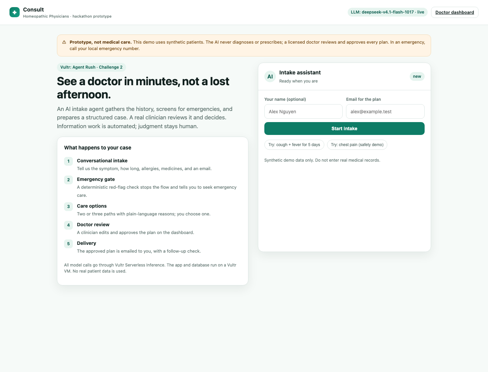
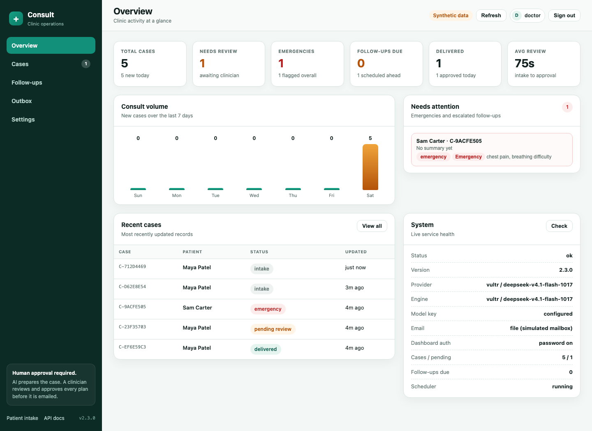
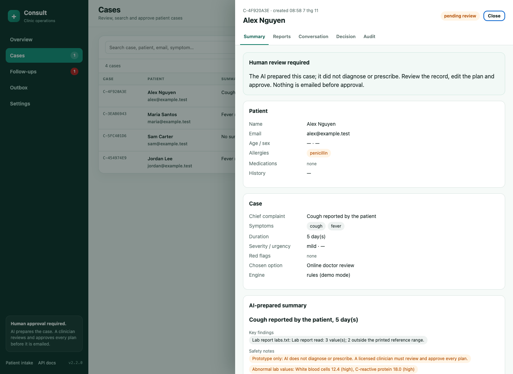

# Consult Homeopathic Physicians

**AI-assisted patient intake with a licensed doctor in the loop.**

[](https://github.com/pham-canh/consult-homeopathic/actions/workflows/tests.yml)

Event: [Vultr: Agent Rush Hackathon](https://lablab.ai/ai-hackathons/vultr-hackathon)
Live demo: https://consult-homeopathic.207.148.72.102.sslip.io/
Challenge: **2 — Powering the Future of Work**

> This is the complete, independently deployed submission build for Challenge 2.
> The public app, API, and doctor dashboard run on a dedicated Vultr VM.

The agent collects symptoms and history in a short conversation, screens for
emergency red flags, reads an uploaded lab report, proposes care options, and
prepares a structured case. A licensed doctor reviews that case on a dashboard,
edits the plan, and approves it. Only then is the plan emailed to the patient.
The agent never diagnoses and never prescribes.

This is a code-only submission; no demo video is included.

## Try the live demo

| | |
|---|---|
| Live patient app | https://consult-homeopathic.207.148.72.102.sslip.io/ |
| Doctor dashboard | https://consult-homeopathic.207.148.72.102.sslip.io/doctor |
| Demo user | `doctor` |
| Demo password | Provided in the lablab submission access notes; intentionally not committed to this public repository |
| Data | Synthetic only; no real patient information |

Fast path for judges:

1. Complete a short intake on the patient app and choose a care option.
2. Open the doctor dashboard, sign in as `doctor`, and open the pending case.
3. Review the summary, lab report, conversation and safety warnings, then approve
   a plan. The plan appears in **Outbox** and a follow-up check-in is scheduled.
4. Open the follow-up link and report a red-flag symptom. The case escalates to
   **Emergency** and appears in the dashboard attention queue.

The dashboard needs a login because it exposes patient cases and can approve
plans, prescriptions and follow-up messages. Patient intake, care-option choice
and public follow-up links stay open so judges can test the full loop without
staff credentials.

## What is in this build

| Area | Implemented |
|---|---|
| Conversational intake | Plain-language chat with follow-up questions and structured extraction |
| Emergency gate | Deterministic red-flag rules run before every model call; negation-aware; cannot be overridden |
| Lab report reader | `.txt`, `.md`, `.csv`, `.pdf` upload; deterministic value parsing plus an optional model summary; abnormal values flagged |
| Care options | Two or three care paths with plain-language reasons; the patient chooses one |
| Doctor dashboard | Protected operations dashboard with overview metrics, searchable case queue, case drawers (summary, reports, conversation, decision, audit), follow-up queue, outbox and runtime settings |
| Human approval | `/approve` is the only path that sends a plan; approval is single-use and blocked for emergency cases |
| Email delivery | Real SMTP when configured, otherwise a labelled `.eml` outbox |
| Follow-up agent | Check-in is scheduled after approval, emailed with a token link, and escalates automatically on a red flag |
| Safety checks | Allergy cross-reactivity and a short, visible drug-interaction list |
| Audit trail | Every patient, agent, safety, and doctor action is timestamped |
| Model providers | No model id bundled; Vultr, OpenAI, Anthropic, Gemini, and any OpenAI-compatible endpoint |
| Operations | Health check, SQLite persistence, Dockerfile, systemd unit, Caddy HTTPS, Vultr provisioning script |

Core and stretch features from the project overview are therefore present. The
only deliberately excluded items are real patient data, payments, video calls,
doctor identity verification, and automated diagnosis or prescribing.

## Screenshots

Patient intake with lab upload:



Clinic operations dashboard with volume, attention queue and runtime status:



Case record with tabbed summary, reports, conversation, decision and audit trail:



## Architecture

```
Patient browser ─┐
                 ├─ FastAPI on a dedicated Vultr VM ── configured inference provider
Doctor browser  ─┤        │
Follow-up link  ─┘        ├── SQLite case store + audit trail + follow-up queue
                          ├── uploaded reports on local disk
                          └── email (SMTP or labelled .eml outbox)
```

One JSON case record is shared by both flows. Key fields: `case_id`, `patient`
(name, email, age, sex, allergies, medications, history),
`chief_complaint`, `symptoms`, `duration_days`, `severity`, `red_flags`,
`urgency`, `reports`, `care_options`, `selected_option`, `summary`, `doctor`,
`email`, `follow_up`, `transcript`, `needs_attention`, and `status`
(`intake` → `pending_review` → `delivered`, or `emergency`).

## Run locally

```bash
python3 -m venv .venv && . .venv/bin/activate
pip install -r requirements.txt -r requirements-dev.txt
cp .env.example .env
python3 scripts/configure_model.py   # choose a provider, model, and key
python3 app.py                       # http://127.0.0.1:8000
```

No model is hard-coded. The app uses the provider named in `INFERENCE_PROVIDER`,
or the first provider with a key:

| Provider | Key env | Model env | Base URL default |
|---|---|---|---|
| Vultr (submitted demo) | `VULTR_API_KEY` | `VULTR_MODEL` | `api.vultrinference.com/v1` |
| OpenAI / ChatGPT | `OPENAI_API_KEY` | `OPENAI_MODEL` | `api.openai.com/v1` |
| Anthropic / Claude | `ANTHROPIC_API_KEY` | `ANTHROPIC_MODEL` | `api.anthropic.com/v1` |
| Google / Gemini | `GEMINI_API_KEY` or `GOOGLE_API_KEY` | `GEMINI_MODEL` | `generativelanguage.googleapis.com/v1beta` |
| Any OpenAI-compatible | `INFERENCE_API_KEY` | `INFERENCE_MODEL` | set `INFERENCE_BASE_URL` |

### Switch provider or model

The team can change providers without touching code. The helper writes only the
gitignored, mode-600 `.env`; the key is read with a hidden prompt and never
printed:

```bash
python3 scripts/configure_model.py
python3 scripts/configure_model.py --provider claude --model claude-sonnet-4-5
python3 scripts/configure_model.py --provider openai-compatible \
  --model my-model --base-url http://localhost:11434/v1
python3 scripts/configure_model.py --provider gemini --model gemini-2.5-flash --test
```

Restart the app after saving, then check `/healthz` for the active provider and
model. The same settings can be edited directly in `.env`; supported aliases
include `chatgpt`, `claude`, `google`, `openrouter`, and `ollama`.

On the running VM, use the wrapper. It runs the same hidden-input helper against
`/opt/consult-homeopathic/.env`, restarts the service, and prints `/healthz`:

```bash
./deploy/configure_model.sh
```

The systemd unit loads that optional file after the server env file, so the new
provider takes effect on restart. Changing the local `.env` later does not alter
the VM env; use the wrapper or edit `/etc/consult-homeopathic/consult.env` and
restart.

Without a key the app still runs and says so: intake falls back to the
deterministic rule engine, and `/healthz` reports `llm_key: false`.

Run the tests (no network, no key, 76 tests):

```bash
CONSULT_FAKE_LLM=1 CONSULT_DISABLE_SCHEDULER=1 python3 -m pytest tests/ -q
```

## Dashboard access

`/doctor` is the clinic operations console:

- **Overview** — new-case trend, pending/emergency counts, follow-ups due,
  delivery stats, attention queue, recent cases and live service health.
- **Cases** — server-side search across case id, patient, email, complaint and
  red flags, plus status/urgency filters. Each record opens in a drawer with
  Summary, Reports, Conversation, Decision and Audit tabs.
- **Follow-ups** — due, scheduled and sent check-ins with patient links.
- **Outbox** — every plan, check-in and escalation message, including the exact
  email body written to disk in file mode.
- **Settings** — provider/model, engine, storage, email mode and auth state.

**Live access:** open `/doctor`, sign in with user `doctor`, and use the demo
password from the lablab submission access notes. The credential is not stored
in this repository; it exists only in the server environment.

Set `CONSULT_DASHBOARD_PASSWORD` to require a shared clinic password. Sessions
are HMAC-signed, `HttpOnly`, `SameSite=Lax` cookies that last 8 hours; when the
variable is empty the dashboard stays open for local demos. `CONSULT_DASHBOARD_USER`
sets the display name and `CONSULT_SESSION_SECRET` optionally pins the cookie key.
When enabled, unauthenticated staff requests receive `401` and `/doctor`
redirects to `/login`. The patient intake and public follow-up pages stay public.

To run locally with the same protection:

```bash
CONSULT_DASHBOARD_PASSWORD=choose-a-local-password python3 app.py
```

Remove the variable to return to the open local demo mode. On the VM, edit
`/etc/consult-homeopathic/consult.env` and restart `consult-homeopathic` to
rotate the shared password.

## API

| Method | Path | Purpose |
|---|---|---|
| GET | `/` | patient intake |
| GET | `/doctor` | clinic operations dashboard (password-protected when configured) |
| GET | `/login` | dashboard sign-in page |
| GET | `/follow-up/{token}` | public check-in page |
| GET | `/healthz` | storage, model, key, scheduler, dashboard auth flag |
| POST | `/api/auth/login` | exchange the dashboard password for a session |
| GET | `/api/auth/me` | current session state |
| POST | `/api/auth/logout` | clear the session cookie |
| POST | `/api/intake/start` | open a case (name, email) |
| POST | `/api/intake/{id}/message` | one patient turn (safety gate + model) |
| POST | `/api/intake/{id}/report` | upload a lab report |
| POST | `/api/cases/{id}/choose` | choose a care option |
| GET | `/api/doctor/cases` | case queue with `status`, `q`, `urgency`, `limit`, `offset` |
| GET | `/api/dashboard` | overview metrics, trend, attention and recent cases |
| GET | `/api/followups` | follow-up queue with `state` filter |
| POST | `/api/cases/{id}/approve` | doctor decision, email plan, schedule follow-up |
| POST | `/api/cases/{id}/follow-up` | log a follow-up report |
| POST | `/api/cases/{id}/follow-up/send` | send the scheduled check-in now |
| GET/POST | `/api/follow-up/{token}` | read/submit the public check-in |
| GET | `/api/mailbox` | sent-plan and check-in outbox |
| GET | `/api/emails/{id}` | open one outbox email by id |
| GET | `/api/cases/{id}` | full case, reports, audit trail, warnings |

Staff endpoints (`/api/doctor/cases`, `/api/dashboard`, `/api/followups`,
case detail/approve/follow-up, mailbox and email bodies) require a valid session
when `CONSULT_DASHBOARD_PASSWORD` is set. Patient intake, choice and public
follow-up endpoints stay open. Invalid state transitions return `409`; invalid
uploads return `400`; unknown cases and tokens return `404`; unauthenticated
staff requests return `401`.

## Safety design

- **No diagnosis, no prescribing by AI.** The agent gathers information and
  drafts a summary. Prescription text is entered by the doctor.
- **Human approval is a hard gate.** `/approve` is the only path that sends a
  plan, requires `pending_review`, and cannot run twice. Emergency cases cannot
  be approved.
- **Emergency screening is deterministic.** A regex red-flag list runs before the
  model. A model flag can also stop the flow, but the rule gate can never be
  overridden. Negated phrases ("no chest pain") are ignored unless a contrast
  reintroduces a symptom ("no fever but chest pain").
- **Follow-up escalation is deterministic.** A red flag in a check-in moves the
  case to `emergency`, marks `needs_attention`, and alerts the clinic if
  `CONSULT_DOCTOR_EMAIL` is set.
- **Honest labels.** Every reply records its engine (`vultr / <model>` or
  `rules (...)`). A fallback is never presented as a model answer.
- **Synthetic data only.** The prototype is not a medical device and must not be
  used with real patient records.

## Deploy on a dedicated Vultr VM

This build is meant to own a VM so it never shares a database or service with
another project. The provisioning script creates a new Ubuntu 24.04 instance,
a firewall group, and an SSH key entry through the Vultr API.

```bash
# Put a Vultr API key with instance/firewall permissions in ~/.vultr_api_key
chmod 600 ~/.vultr_api_key

./deploy/provision_and_deploy.sh
```

Defaults: region `sgp`, plan `vc2-1c-2gb`, label `consult-homeopathic`. Override
with `VULTR_REGION`, `VULTR_PLAN`, or `VULTR_LABEL`. The script:

1. creates a firewall group (22, 80, 443) and the instance;
2. waits for the public IP;
3. rsyncs the tree to `/opt/consult-homeopathic`;
4. writes `/etc/consult-homeopathic/consult.env` from the local `.env` plus the
   server public URL (never committed);
5. creates the venv, installs requirements, installs the systemd unit;
6. configures Caddy HTTPS on `consult-homeopathic.<ip>.sslip.io`;
7. prints `/healthz`.

Later updates:

```bash
CONSULT_HOST=root@<ip> ./deploy/deploy.sh
./deploy/configure_model.sh           # change provider/key/model on the VM
```

Server layout: code `/opt/consult-homeopathic`, data
`/var/lib/consult-homeopathic`, env `/etc/consult-homeopathic/consult.env`, unit
`consult-homeopathic.service`.

### Docker alternative

```bash
cp .env.example .env   # fill a provider
docker compose up -d --build
```

The image runs as a non-root user and stores SQLite, reports, and emails in the
`/data` volume.

## Demo flow (about two minutes)

1. Patient: "cough and fever for five days, allergic to penicillin", attach a
   small lab report, choose **Online doctor review**.
2. Second patient reports chest pain; the agent stops and shows emergency
   guidance.
3. Clinic dashboard: sign in, scan Overview, open the pending case from Cases,
   inspect the summary, lab values and allergy warning, then approve.
4. Open the outbox and show the exact plan email; the follow-up link is in it.
5. Send the check-in now and open the public link; submit "chest pain" to show
   the automatic escalation and the `needs_attention` banner.

To make step 5 instant in a demo, set `FOLLOWUP_DAYS=0`.

## Submission assets

- `docs/SUBMISSION.md` — title, descriptions, tags, limitations
- `docs/ARCHITECTURE.md` — flow and threat boundaries
- `docs/ui.png`, `docs/doctor.png`, `docs/case.png` — intake, dashboard and case-record screenshots
- This is a code-only submission; no video is included.

## What is deliberately out of scope

Real patient data, real payments, video calls, doctor identity verification, and
automated diagnosis or prescribing. The dashboard supports shared-password
access for this demo; production still needs per-user identity, MFA, consent,
encryption at rest, and health-data compliance.

## Team

- Canh Pham — backend, inference integration, workflow, deployment

This is a hackathon prototype. It is not a medical device and does not provide
medical advice.
